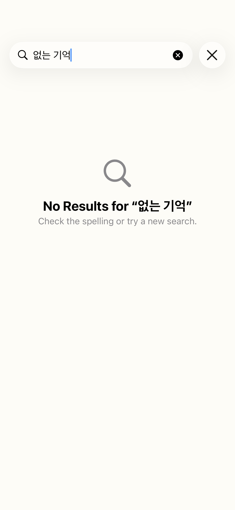
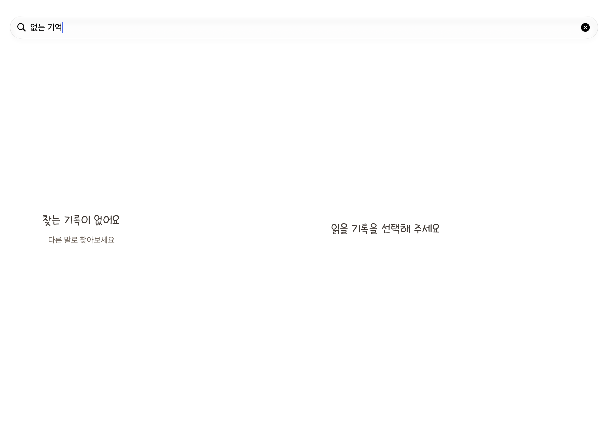

# 검색 화면 한국어 표시 수정 — #43

2026-10-11. [이슈 #43](https://github.com/Youngmin322/whisper/issues/43)의 검색 화면 영어 표시를 재현하고 수정했습니다.

## 재현과 원인

iOS 26.5 iPhone 17 Pro 시뮬레이터에서 한국어·한국(`ko-KR`) 환경으로 실제 앱 번들을 실행했습니다. 기록이 있는 상태에서 `없는 기억`을 검색하면 iPhone의 시스템 결과 없음 화면에 영어 제목과 안내가 표시됐습니다.

빌드된 앱의 `CFBundleDevelopmentRegion`과 `Bundle.main.preferredLocalizations`는 모두 `en`이었고 한국어 지원 선언은 없었습니다. 앱의 제목·검색 안내는 한국어 리터럴인데 `ContentUnavailableView.search` 등 시스템 문구는 영어 앱 언어를 선택한 상태였습니다. iPad의 결과 없음 안내는 이미 앱 문구로 작성되어 한국어였습니다.

## 수정

- `Whisper.xcodeproj/project.pbxproj`: `developmentRegion`과 `knownRegions`의 언어를 `ko`로 일치시켰습니다.
- `Whisper/Info.plist`: `CFBundleLocalizations = [ko]`를 선언했습니다. 현재 번역 리소스 폴더 없이 앱 문구를 관리하는 구성에서도 실제 번들이 한국어 지원을 알립니다.
- 지원 언어와 기본 언어는 한국어이며, 영어·일본어 등 미지원 언어는 한국어로 폴백합니다. README에 현재 정책과 향후 언어 추가 절차를 기록했습니다.

[Apple의 앱 언어 선택 안내](https://developer.apple.com/library/archive/qa/qa1828/_index.html)에 따라 지원 언어와 기본 언어를 앱 문구에 맞췄습니다. 검색의 시스템 안내는 기존 `ContentUnavailableView.search`를 사용하며, 향후 [#44](https://github.com/Youngmin322/whisper/issues/44)에서 지원 언어와 번역 리소스를 함께 추가하면 같은 시스템 UI가 해당 언어를 선택할 수 있습니다.

검색 결과 구성·기록 식별자·저장 데이터·날짜 키·상세 화면 경로는 이번 수정의 변경 대상에 포함하지 않았습니다.

## 검증 결과

| 환경 | 확인한 내용 | 결과 |
|---|---|---|
| iPhone 17 Pro, iOS 26.5, `ko-KR` | 검색 언어·검색 결과·보관함 관련 3개 suite | 12개 테스트 통과 |
| iPad Pro 13-inch (M5), iPadOS 27.0, `ko-KR` | 검색 언어·검색 결과·선택한 상세 화면·창 크기 변경 관련 3개 suite | 15개 테스트 통과 |
| iPhone 17 Pro, iOS 26.5, 영어·미국 | `Locale.preferredLanguages = [en]`에서도 `Bundle.main.preferredLocalizations = [ko]`, 검색 언어 1개 suite | 3개 테스트 통과 |

추가한 `SearchLocalizationTests`는 빌드된 앱의 언어 선언과 폴백을 검사하고, 앱 언어를 별도로 덮어쓰지 않은 실제 검색 화면을 띄웁니다. 검색 시작·결과 없음·결과 있음·취소·기록 없음 화면을 캡처한 뒤 Vision으로 표시 문구를 읽어 한국어 안내와 결과 필터링, 취소 후 전체 결과 복원을 검증합니다. 캡처도 직접 확인했습니다.

실기기와 iOS 26.0에서의 확인은 이번 검증에 포함하지 않았습니다. 이번 결과는 현재 작업 디렉터리의 기존 변경을 포함한 Debug 빌드 기준입니다.

커밋 준비 시에는 커밋 대상 파일만 별도 디렉터리로 추출해 기존 미커밋 변경 없이 다시 빌드했습니다. 이 구성에서도 iPhone 17 Pro(iOS 26.5)와 iPad Pro 13-inch(iPadOS 27.0)의 검색 언어 회귀 테스트가 각각 3개씩 통과했습니다.

검증 로그는 임시 경로이며 이후 정리될 수 있습니다.

- `/private/tmp/whisper-search-iphone26.log`
- `/private/tmp/whisper-search-ipad27-final.log`
- `/private/tmp/whisper-search-english-fallback-final.log`
- `/private/tmp/whisper-search-commit-tests.log`

## 실제 화면

| iPhone 수정 전 | iPhone 수정 후 |
|---|---|
|  |  |

iPad 결과 없음 화면:

같은 폴더의 `iphone-*.png`, `ipad-*.png`는 검색 시작·결과 있음·취소·기록 없음 상태의 검증 캡처입니다. 모두 테스트용 메모리 저장소의 샘플 기록을 사용했습니다.
