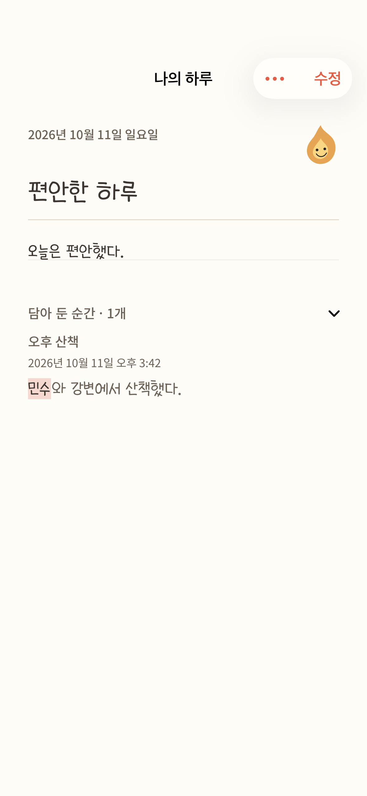
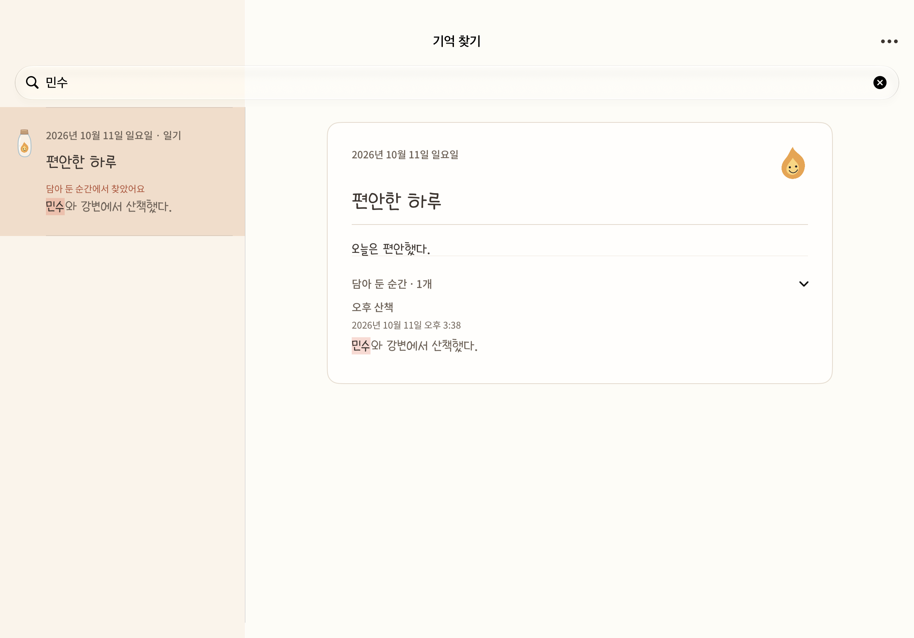

# 일기 중심의 검색 결과 — #35

2026-10-11. [이슈 #35](https://github.com/Youngmin322/whisper/issues/35)의 검색 일치 문장과 일기 탐색을 구현했습니다.

## 동작

- 일기 제목과 날짜를 유지하면서 검색어 주변의 실제 문장을 미리보기로 표시하고, 일치한 부분을 강조합니다. 본문·제목·감정·기존 회고 중 어디서 찾았는지도 표시합니다.
- 완성한 일기에도 검색어가 있다면 그 일기의 문구를 우선합니다.
- 원본 순간에서만 찾으면 `담아 둔 순간에서 찾았어요`라는 출처를 표시합니다. 여러 원본에서 찾으면 개수를 표시하되 일기 결과는 하나로 유지합니다.
- 결과를 선택하면 해당 일기를 읽습니다. 원본에서만 찾은 경우 아래의 `담아 둔 순간`을 자동으로 펼치고, 일치한 원본을 먼저 배치하며 해당 문장을 강조합니다.
- 일반 진입이나 일기 자체에서 찾은 경우 원본 구획은 기본적으로 접혀 있습니다. 펼친 원본의 제목을 누르면 기존 순간 상세도 열 수 있습니다.
- 미보관 순간 검색, 빈 검색, 기존 날짜별 정렬을 유지합니다. 원본 삭제 후에는 그 원본에서만 찾던 검색 결과가 사라집니다. iPad에서 해당 결과를 읽던 경우 선택도 비웁니다.
- 표시 변경은 순간·일기 본문과 사진, 저장 날짜 및 영속 스키마를 수정하지 않습니다.

## 구현

`JournalArchiveIndex`가 검색 필드, 원본 ID, 일치 문장과 검색어를 함께 반환합니다. iPhone과 iPad는 같은 미리보기와 강조 표시를 사용합니다. 검색 문맥을 일기 읽기 화면까지 전달하고 원본 구획에서 사용합니다. 원본 문장은 현재 저장소의 내용으로 다시 계산하여 이전 검색 문장을 계속 표시하지 않습니다.

## 검증

| 환경 | 검증 | 결과 |
|---|---|---|
| iPhone 17 Pro / iOS 26.5 / 한국어·한국 | 기존 검색·보관함·탐색 및 새 일치 문장 테스트 | 23개 통과 |
| iPad Pro 13-inch (M5) / iPadOS 27.0 / 한국어·한국 | 기존 검색·보관함·탐색 및 새 일치 문장 테스트 | 24개 통과 |
| 최종 정렬·강조 보정 후 같은 두 기기 | 새 검색 데이터·화면 테스트 | iPhone 8개, iPad 7개 통과 |
| 기존 미커밋 변경을 제외하고 이번 검색 수정만 적용한 소스 | 시뮬레이터 앱 빌드 / Xcode 27.0 | 성공 |
| 커밋 대상만 분리한 소스 / 기존 글꼴 설정 | 새 검색 데이터·화면 테스트 | iPhone 8개, iPad 7개 통과 |

데이터 테스트는 긴 본문의 중간 일치, 반복 일치 강조, 여러 원본을 한 일기로 묶기, 일기 우선순위, 제목·감정 일치, 원본 삭제, 미보관 순간과 빈 검색, 영문 대소문자와 이모지 문맥을 검증합니다.

화면 테스트는 실제 SwiftUI 화면을 테스트용 메모리 저장소로 띄워 캡처하고 Vision으로 문구를 읽습니다. iPhone의 검색 입력은 시스템 검색 컨트롤러에 전달하고, 일기 도착 화면은 검색 문맥을 전달해 별도로 렌더링합니다. iPad는 선택 상태를 변경해 읽기 패널과 좁은 창의 탐색 경로, 검색어 변경과 원본 삭제 후 상태를 확인합니다. 물리 기기의 터치 조작이나 전체 사용자 흐름을 자동화한 UI 테스트는 이번 검증에 포함하지 않았습니다.

같은 폴더의 화면은 최종 보정 이후의 테스트 데이터 캡처입니다. 현재 작업 디렉터리의 기존 글꼴 변경도 화면에 포함되어 있습니다. 독립 소스 빌드는 기존 글꼴 설정으로 확인했습니다.

검증 로그는 정리될 수 있는 임시 파일입니다.

- `/private/tmp/whisper-search-matches-tests.log`
- `/private/tmp/whisper-search-matches-layout-tests.log`
- `/private/tmp/whisper-search-matches-clean-build.log`
- `/private/tmp/whisper-search-matches-phone-capture.log`
- `/private/tmp/whisper-search-match-commit-tests.log`

## 화면

| iPhone 검색 결과 | iPhone 일기와 펼친 원본 |
|---|---|
|  |  |

