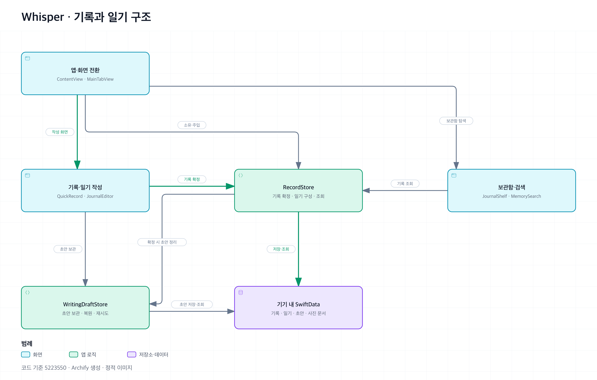

# Whisper

순간의 글과 사진을 남기고 하루의 일기로 모으는 iOS 앱입니다.

## 앱 구조

화면에서 작성한 내용을 `WritingDraftStore`가 초안으로 보관하고, `RecordStore`가 기록·일기로 확정합니다. 두 저장소는 같은 SwiftData `ModelContext`를 공유합니다.



- [새 순간의 초안 저장과 확정 흐름](Docs/architecture/moment-save.png)
- [다이어그램 원본·HTML 열기와 재생성 안내](Docs/architecture/README.md)

구조도는 코드 기준 `5223550`을 바탕으로 Archify로 생성했습니다.

## 개발 환경

- Xcode 26 이상(Swift 6.2 이상)
- iOS 26 이상
- 테스트용 iOS 26 이상 iPhone 시뮬레이터

앱 코드는 `Whisper/App`, `Whisper/Features`, `Whisper/Shared`, `Whisper/Data`로 나누고, 기존 디자인 시스템과 iPad 화면은 `Whisper/DesignSystem`, `Whisper/iPad`에서 관리합니다. 이미지·색상은 `Whisper/Resources/Assets.xcassets`, 글꼴은 `Whisper/Resources/Fonts`에 있습니다. 별도 Swift 패키지 없이 `Whisper.xcodeproj`를 열면 빌드할 수 있습니다.

## 표시 언어

한국어(`ko`)와 영어(`en`)를 지원하며, 개발 언어와 최종 폴백은 한국어입니다. iOS의 선호 언어 순서와 앱별 언어 설정을 따릅니다. 앱의 설정 → 언어 설정 열기에서 시스템 설정으로 이동할 수 있으며, 시스템 검색 안내와 취소 버튼도 선택한 앱 언어로 표시됩니다.

앱 설정의 언어 메뉴에서 ‘시스템 설정 따르기’, ‘한국어’, ‘English’를 선택할 수 있습니다. 선택은 기기에 보관하고 앱을 다시 실행하지 않아도 문구와 날짜 표시에 반영합니다. 화면을 다시 생성하지 않으므로 탐색 위치와 작성 중인 초안 상태를 유지합니다. ‘시스템 설정 따르기’는 iOS가 이 앱에 선택한 언어를 사용하며, 지원하지 않는 언어는 한국어로 표시합니다. 사진 선택기·권한 팝업·설정 앱·App Intents 같은 시스템 화면은 iOS의 언어 설정을 따릅니다.

화면·오류·접근성 문구는 `Whisper/Resources/Localizable.xcstrings`, 사진 접근 권한 안내는 `Whisper/Resources/InfoPlist.xcstrings`에서 관리합니다. 앱에서 생성하는 새 문구는 SwiftUI와 UIKit 모두 `String(localized: "한국어 원문", bundle: WhisperLocalization.bundle, locale: WhisperLocalization.locale)`으로 작성하고 Xcode의 String Catalog에 영어 번역을 추가합니다. 언어 변경에 반응하도록 번역 문구를 `static let`에 보관하지 않고 계산 프로퍼티에서 읽습니다. App Intents의 `LocalizedStringResource` 문구도 같은 카탈로그에 포함됩니다. 숫자가 들어간 문구는 정수를 보간하고 영어의 `one`·`other` 복수형을 번역하세요. 문장을 조각내거나 사용자 글을 현지화 키로 사용하지 않습니다.

빌드 시 Swift 컴파일러가 추출한 `.stringsdata`를 Xcode에서 카탈로그와 동기화합니다. CLI에서 새 키를 확인할 때는 `xcstringstool sync <카탈로그 경로> --stringsdata <빌드에서 생성한 .stringsdata 경로들>`을 사용할 수 있습니다. 번역 누락 시 한국어 원문으로 표시되므로, 배포 전 두 카탈로그에서 영어 번역 누락·오래된 키와 보간 인자를 확인하세요. 언어를 추가할 때는 카탈로그, 프로젝트의 `knownRegions`, `Info.plist`의 `CFBundleLocalizations`를 함께 갱신합니다.

날짜·시간·요일은 앱 언어와 사용자의 지역에 맞춰 표시합니다. 저장용 날짜 키·시간대·감정의 원래 식별값과 사용자 글·제목·사진·초안은 언어 변경으로 바꾸지 않습니다. 영어 감정 이름으로 기존 기록을 검색할 수 있고, 기존 한국어 감정 검색도 유지됩니다.

영어 문구에서는 짧은 기록을 `moment`, 하루치 일기 한 편을 `journal entry`로 구분합니다. 새 순간 작성 동작은 `Capture a moment`, 하루치 삭제는 `Delete entry`로 표현합니다. 불꽃·병은 앱의 시각적 비유로 유지하되 버튼에는 실제 동작을 적습니다. 예를 들어 병에 모으기는 저장 완료가 아닌 작성 화면 진입이므로 `Gather today's moments`로 안내합니다. 저장 실패 시에는 화면에 남은 글과 저장된 초안을 구분해 설명합니다. 원어민 사용자 검수는 아직 하지 않았습니다.

미국·영국처럼 같은 영어라도 지역에 따라 날짜·시간과 달력의 시작 요일이 달라집니다. 사용자가 선택한 12·24시간제와 주 시작 요일도 표시 locale에 보존합니다. 저장 날짜를 구분하는 그레고리력 정책은 유지합니다.

현지화 검증은 `bash Scripts/test-ios.sh -testLanguage ko -testRegion KR`로 전체 테스트를 실행하고, 영어로 `AppLocalizationTests`, `SearchLocalizationTests`, `WhisperTypographyTests` 및 작성·초안·사진 관련 테스트를 실행합니다. iPhone과 iPad에서 검색의 시작·빈 결과·취소, 긴 문구와 접근성 글자 크기를 확인하고, 한국어로 만든 글과 사진을 영어로 재실행해 읽고 수정할 수 있는지도 확인합니다.

## 작성 중인 기록

‘순간 남기기’는 기존 초안과 별개로 항상 새 글을 시작합니다. 닫은 순간 초안은 각각 보관되며, 홈의 ‘작성 중인 기록 이어 쓰기’에서 선택해 계속 작성할 수 있습니다. 글·사진·감정은 초안별로 유지되고, 한 초안을 저장하거나 버려도 다른 초안은 남습니다.

## 검증

```sh
bash Scripts/test-ios.sh
```

설치된 iPhone 시뮬레이터를 자동 선택합니다. 특정 기기는 `WHISPER_SIMULATOR_ID`, 빌드 경로는 `WHISPER_DERIVED_DATA` 환경 변수로 지정할 수 있습니다. 추가 `xcodebuild` 인자는 스크립트 뒤에 전달합니다.

서명 없이 Release 아카이브를 검증하려면:

```sh
xcodebuild archive \
  -project Whisper.xcodeproj -scheme Whisper \
  -destination 'generic/platform=iOS' \
  -derivedDataPath /tmp/whisper-release \
  -archivePath /tmp/Whisper.xcarchive \
  CODE_SIGNING_ALLOWED=NO
```

배포용 아카이브는 Xcode에서 서명 설정과 버전을 확인한 뒤 생성합니다. 배포 전 실기기에서 기존 기록·사진 유지, 초안 이어 쓰기, 수정·삭제와 일기 복구, 접근성 글자 크기 및 VoiceOver를 확인하세요.

## Slack 배포 자동화

Slack의 `/testflight [dev|main]`으로 내부 TestFlight 빌드를 올리고, `/review 버전 빌드번호`로 기존 빌드를 App Store 심사에 제출하는 구성을 제공합니다. Cloudflare Worker와 GitHub Actions를 사용합니다. 계정 연결·서명·API 키 설정과 첫 실행 절차는 [설정 안내](Docs/slack-deploy.md)를 참고하세요.
